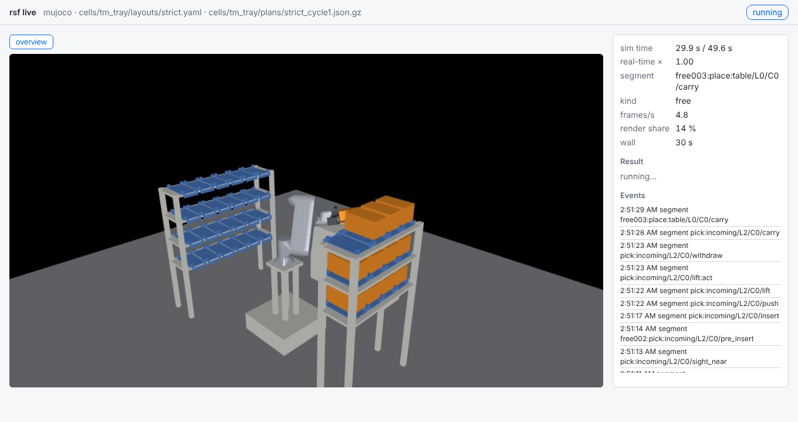

# Live view (P7): watching a run from another computer

While `tools/sim_workflow.py` replays a plan, the simulator renders camera views
(Isaac Sim: RTX; MuJoCo: its OpenGL renderer) on the computer that runs it, and
serves them, with the run's status and events, over HTTP. A browser on any host
shows them; programs read the same API. Nothing is rendered in the browser.



## Use

On the computer that simulates:

```bash
python tools/sim_workflow.py cells/tm_tray/layouts/strict.yaml cells/tm_tray/workflows/inspect_and_sort.yaml \
    --plan cells/tm_tray/plans/strict_cycle1.json.gz --backend isaac --transfers 2 \
    --out reports/isaac/cycle1.json --live 8765 --live-hold 60
```

It prints `[live] http://localhost:8765/`. `--live 8765` listens on that
computer only (127.0.0.1). From another computer, either:

* **SSH tunnel** (no firewall change): run it through
  `tools/isaac/remote_isaac.sh run --view 8765 --cmd "python tools/sim_workflow.py ... --live 8765"`
  and open `http://localhost:8765/` on the main computer while it runs; or
* **the network**: `--live 0.0.0.0:8765`, open `http://<gpu-box>:8765/`.

| option | default | |
|---|---|---|
| `--live [HOST:]PORT` | off | serve the live view (host 127.0.0.1 unless given) |
| `--live-view SPEC` | `overview` | a view: `overview` (the whole cell) or JSON `{"name", "eye", "target", "fov_deg", "width", "height"}` (m, deg, px); repeatable |
| `--live-fps` | 5 | rendered frames per **wall-clock** second, all views together |
| `--live-size W H` | 960 540 | size of views without their own |
| `--live-pace X` | 0 | no faster than X × real time (0: as fast as it runs; MuJoCo runs faster than real time) |
| `--live-hold S` | 0 | keep serving S s after the run (-1: until Ctrl-C) |
| `--live-quality` | 80 | JPEG quality |

| `--live-control` | off | pause / resume / step / pace / stop from the viewer (token) |
| `--live-debug` | off | a Python console in the running simulation (token; implies `--live-control`) |
| `--live-cert F --live-key F` | | serve HTTPS (PEM certificate and key) |
| `--debugpy [HOST:]PORT` | off | listen for a debugger (VS Code *Remote Attach*; host 127.0.0.1 unless given); `--debugpy-wait` waits for it |

Example of a second view, from above the table:
`--live-view '{"name": "top", "eye": [0.0, 0.3, 3.0], "target": [0.0, 0.3, 0.8], "fov_deg": 40}'`.

MuJoCo renders offscreen with `MUJOCO_GL=egl` (set when there is no display);
`MUJOCO_GL=osmesa` without a GPU.

## Cost

Rendering runs on the simulation thread (Isaac's app loop and MuJoCo's GL context
need it), at most `--live-fps` times per wall-clock second, so its share of the run is
bounded; the status shows it (`render share`). JPEG encoding runs on another thread.

* MuJoCo (osmesa, no GPU, 960×540, 5 fps): 14 % of the wall time; at
  `--live-pace 1` the run kept real time (1.00×), 4.7 frames/s.
* Isaac Sim RTX on a Kaggle T4: one 1280×960 frame took 0.22–0.29 s
  (`render_probe.py`), so 5 fps would more than double the run there (physics alone
  ran at 0.75× real time). An RTX desktop GPU is several times faster; `--live-fps`
  and `--live-size` trade picture for speed. With a cold shader cache the first frame
  takes minutes: it is rendered before the run starts (`warmup` event), not in it.

### Isaac: which render mode (`render_mode`)

How the views are drawn without stepping physics differs between Isaac Sim versions
(Replicator fills its annotators while the timeline plays, or when its orchestrator
steps). `IsaacParams.render_mode`:

| mode | how | |
|---|---|---|
| `play` (default) | the timeline plays; an app update renders | as Isaac's own `SimulationContext`; Isaac Sim 5.0: works, 7.5 ms per 640×360 frame |
| `step` | `rep.orchestrator.step(rt_subframes=1, delta_time=0)` | Isaac Sim 5.0: works, 44 ms |
| `update` | an app update, the timeline stopped | Isaac Sim 5.0: **no pictures** (Replicator captures only while the timeline plays) |

In all of them the app loop never steps physics (`/app/player/playSimulations` is off
from the start; `run` steps it). Black pictures (the viewer counts *blank frames*)
mean the mode does not suit this Isaac Sim. Find the one that does, on the GPU computer:

```bash
python tools/isaac/live_probe.py            # or: ~/isaacsim/python.sh tools/isaac/live_probe.py
```

It tries each mode in its own Isaac app (about a minute each), writes
`reports/isaac/live_probe.json` (blank frames, whether the arm moves in the picture,
seconds per render, whether the run changed) and PNGs of the first and last frame,
and names the mode to use: `--set render_mode='"step"'` on `sim_workflow.py`.

Rendering does not change the run: MuJoCo gives bit-identical results with and
without it (`tests/test_live.py`). In Isaac Sim 5.0 an app update rounds PhysX's float32
state by at most an ULP (6e-8 rad, in every mode, pictures or not; `live_probe.py`):
far below anything the judge measures; the checks allow 1e-6 rad. In Isaac the app update that renders does not
step physics (`/app/player/playSimulations` off during it, as Isaac's own
`SimulationContext.render`); `tests/test_isaac.py::test_live_view_renders_and_leaves_the_run`
checks that and that the pictures show the arm move. **That test has to run on a GPU**
(not yet run: no GPU here). With Isaac Sim's own Python (the standalone package's
`python.sh`; the test is skipped by a Python without `isaacsim`):

```bash
OMNI_KIT_ACCEPT_EULA=YES python -m pytest tests/test_isaac.py -k live_view -v
```

Isaac Sim 5.0 (standalone, Python 3.11) and 6.2 (pip, Python 3.12) are both meant to work.

## Control and the debug console

`--live-control` adds Pause, Resume, Step (0.1 s, 1 s), a pace choice and Stop to the
viewer; `--live-debug` adds a Python console. Both need a token: printed where the run
starts (or set with `RSF_LIVE_TOKEN`), entered in the viewer or passed in its address
(`http://host:8765/#token=...`; the page keeps it for the tab and removes it from the
address bar). Programs send it as `Authorization: Bearer <token>`.

* **Pause / step** hold the simulation between two samples (0.02 s): nothing in the
  run changes (the first strict transfer paused, stepped and resumed gives the same
  report). Frames keep coming while paused. *Stop* ends the run without judging
  (`state: stopped`, exit code 3).
* **The console** runs code in the simulation process, on the simulation thread, at
  the next sample or while paused (Isaac Sim and MuJoCo can only be called there).
  At hand: `cell`, `world`, `workflow`, `traj`, `hub`, `capture`, `np`, `t` (the
  sample's time), `pause()`, `step(dt)`, `resume()`; names you define stay for the
  next call. The last expression's value comes back (like a REPL), with the output.
  E.g. the joints in degrees: `np.round(np.degrees(cell.d.qpos[:6]), 2)` (MuJoCo) or
  `cell.art.get_dof_positions()` (Isaac). It also runs while `--live-hold` keeps the
  server after the run.
* **What it means:** the console is full access to the computer as the user running
  the simulation (files, network, processes), for anyone with the token. It is off
  unless asked for; every call is logged (event `debug`, with the code, and the run's
  report: `meta.live_debug`, `tainted: true`: code may have changed the run, so its
  verdict is not an acceptance result). Code that never returns holds the simulation:
  nothing can interrupt it from outside; end the process.
* **Network:** the token protects the routes, but over plain HTTP it can be read on
  the network: on a network you do not trust, use an SSH tunnel (`--view`) or HTTPS
  (`--live-cert`/`--live-key`, e.g. `openssl req -x509 -newkey rsa:2048 -nodes -days 365
  -subj /CN=gpu-box -keyout key.pem -out cert.pem`). Without the token header a page
  from another site cannot call these routes (a custom header needs a CORS preflight,
  which the server does not grant).
* **`--debugpy`** is a real debugger (breakpoints, stepping through code) for VS Code.
  It has no password at all: it listens on 127.0.0.1 unless told otherwise, reach it
  through an SSH tunnel (`ssh -L 5678:127.0.0.1:5678 gpu-box`). A breakpoint on the
  simulation thread stops the simulation and the frames (the viewer keeps its status).
  Needs `pip install debugpy` in the simulator's Python.

## API (`rsf.live`, `/api/v1`)

| endpoint | |
|---|---|
| `GET /` | the viewer (`src/rsf/live/web/`) |
| `GET /api/v1/info` | `api` (`rsf.live/1`), run info (backend, layout, plan, `t_end`), streams, `transports` |
| `GET /api/v1/status` | status: `state` (warmup, ready, running, done, failed, error), `t`, `rtf`, `segment`, `render_share`, `frames`, the result at the end |
| `GET /api/v1/events?since=N` | events after *N*: `warmup`, `run_start`, `segment`, `done` / `failed` / `error` |
| `GET /api/v1/stream` | Server-Sent Events: `status` snapshots (≤ `max_hz`, default 10) and `event` |
| `GET /api/v1/video/<view>/mjpeg` | MJPEG (`?fps=` caps it for one viewer); headers `X-Frame-Seq`, `X-Sim-Time` per frame |
| `GET /api/v1/video/<view>/frame.jpg` | the latest frame |
| `POST /api/v1/control` (token) | `{"action": "pause" \| "resume" \| "step" \| "pace" \| "stop", "dt": s, "value": x}` |
| `POST /api/v1/debug/exec` (token) | `{"code": "...", "wait": 10}`: the job (`state`, `ok`, `value`, `output`, `error`, `t`) |
| `GET /api/v1/debug/job/<id>`, `GET /api/v1/debug/log` (token) | a job still running; every job so far |

`/api/v1/info` lists the run's `features` (`control`, `debug`). Without them the
routes do not exist (404); with a wrong token, 401.

From Python (standard library only):

```python
from rsf.live.client import LiveClient
c = LiveClient("http://localhost:8765")
for kind, data in c.events():                 # until the run's server closes
    if kind == "segment":
        print(data["name"])
jpeg = c.frame("overview")
```

## Design: where features go

```
cell (Isaac / MuJoCo) ── add_view(View) / render(name) ──► LiveCapture (the on_sample hook)
                                                                │ RGB → JPEG (worker thread)
                                                                ▼
                                        Hub: video streams · status · event log
                                                                │
                              LiveServer: a route table (LiveServer.route) ── /api/v1/...
                                                                │
                      browser viewer (transports: mjpeg, jpeg)  ·  LiveClient / curl
```

* **A picture source** is a view on a cell; a backend offers `add_view` and `render`.
  More cameras, or one riding on the gripper, are more views.
* **A transport** reads the hub's latest frames: MJPEG now; WebRTC (aiortc/PyAV, H.264
  or VP8, signalling as `POST /api/v1/webrtc/offer`) and WebSocket fit beside it. The
  server lists its transports in `/api/v1/info`; the viewer has a matching table
  (`Viewer.transports` in `viewer.js`). WebRTC's media is UDP: it needs the two computers
  to reach each other directly (not through the SSH tunnel).
* **Endpoints** are routes added with `LiveServer.route` (`auth=True` for the token);
  the hub carries any status field and any event kind. Control (`rsf.live.control`) and
  the console (`rsf.live.debug`) are built that way: a module with a `register(server, ...)`
  and a hook the capture calls on the simulation thread.
