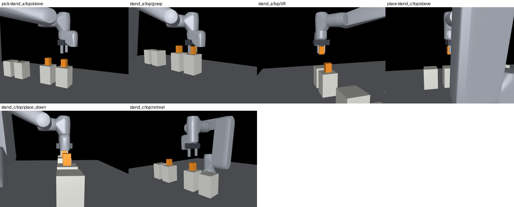

# Making a new cell

This guide walks through adding a new robot cell and workflow, using
`cells/example_pick_place` as the worked example. That cell is the smallest
complete one: a TM5S arm with a box parallel gripper moves blocks from two
stands to two others. Run it first:

```bash
bash cells/example_pick_place/run.sh        # ~20 s, CPU only: audit, expand, teach, plan, simulate, judge
```



`tests/test_example_cell.py` runs the same pipeline (one cycle, ~15 s). Copy
that test for a new cell, too: it runs one cycle by loading the workflow with
`max_cycles: 1`.

Before starting, read [cell_model.md](cell_model.md) for the file formats and
[decisions.md](decisions.md) for the vocabulary.

## 1. The pipeline and its files

```
assets (URDF, meshes)  ─┐
layout  (rsf.layout/1)  ├─► World ─► audit ─► expand ─► teach ─► plan ─► simulate ─► judge
workflow(rsf.workflow/1)┘           (checks)  (tasks)  (joints) (trajectory) (physics) (verdict)
plugin  (Python)        ─┘
```

| Stage | Command | Reads | Writes | Verdict |
|---|---|---|---|---|
| world | `python -m rsf world <layout>` | layout, assets, plugin | (prints a summary) | loads or raises |
| audit | `python -m rsf audit <layout>` | World | (prints, `--json`) | exit 0 = pass |
| expand | `python -m rsf expand <layout> <workflow>` | World, workflow | (prints the task list and the end event) | raises on a bad workflow |
| teach | `python -m rsf teach <layout> --workflow <wf> --out <prefix>` | skills | `<prefix>.json`, `<prefix>.csv` (teach table) | `TEACH n/n`, exit 0 |
| plan | `python tools/plan_workflow.py assemble <layout> <wf> --teach <json> --paths cpu --out <plan.json>` | teach table | `rsf.trajectory/1` + `.summary.json` | `0 problems`, exit 0 |
| simulate + judge | `python tools/sim_workflow.py <layout> <wf> --plan <plan.json> --out <report.json>` | trajectory | judge report | `SIM PASS`, exit 0 |

All commands run from the repository root with `PYTHONPATH=src`. File formats
are in [formats.md](formats.md). Shorter runs while developing:

- `plan_workflow.py ... --cycles N` plans only the first N cycles. Use a teach
  table that covers them.
- `sim_workflow.py ... --transfers N` simulates up to the end of the N-th
  transfer.
- `--set dotted.path=value` on `rsf world/audit/teach` overrides a layout
  value without editing the file.

## 2. Cell layout on disk

```
cells/<cell>/
  assets/            URDFs and meshes (robot + tool, fixtures, objects)
  layouts/*.yaml     where things stand (one file per variant; variants `extends:` a base)
  workflows/*.yaml   what the cell does
  plugin/<name>/     Python package: generators, checks, skills (registered by name)
  teach/ plans/      outputs (teach tables are committed; plans/*.json are gitignored, summaries kept)
  tools/             cell-specific scripts (asset generation, tuning)
  run.sh             optional: the pipeline in one command
```

Nothing under `src/rsf` names a cell. A cell plugs in only through the
registry (`rsf.model.registry.register(kind, name)`), the layout's `process:`
parameters and the naming conventions in §6.

## 3. Assets

- **Robot and tool**: one URDF with the arm, the tool and a tool frame (a link).
  The planner uses EAIK (analytic IK), so the arm must be a 6R arm EAIK can
  decompose (spherical wrist or parallel axes; TM, UR, ABB and KUKA arms qualify).
  Extra movable joints (gripper fingers) are allowed. They are not IK joints;
  skills set them.
  - The example's `assets/arm_gripper.urdf` is generated by
    `tools/make_assets.py`: the tray cell's TM5S plus a box gripper. Generate
    composite assets with a script rather than editing them by hand.
  - Collision geometry is the URDF's `<collision>`. Meshes that are exact boxes
    are turned into boxes automatically.
  - **MuJoCo and PhysX collide meshes as their convex hulls.** Split a concave
    part (a pocket, a recess) into convex pieces. The tray cell's tray is three
    boxes for this reason (docs/assets.md).
  - Masses come from `<inertial>`. MuJoCo needs them on every moving link.
- **Objects** (things the robot moves): a **model**, a URDF or a USD file, per
  object type (docs/cell_model.md, Models).
  - Its frame is where it stands on a feature. The example's block,
    `assets/block.usda`, has its origin at the centre of its underside.
  - Its mass comes from the URDF's links, the USD's `physics:mass`, or `mass:` in
    the layout.
- **Fixtures** (fixed things): a generator (§5.1), `rsf.box`, or a model (URDF or
  USD) under `entities:` / `placements:`.
- A part made of many meshes (a CAD export) is best given as USD: one file holds
  the meshes and their placement. Mark the colliders with `UsdPhysics.CollisionAPI`
  or name them with `collision:`, so the visual meshes do not become obstacles.
  Check the units: an unauthored `metersPerUnit` means centimetres.
  In Isaac's pictures (`--backend isaac`, live view) the part then appears with its
  own materials. The physics stays the colliders (docs/cell_model.md, Models).

## 4. Layout and workflow

Write them as in [cell_model.md](cell_model.md). The example's files are
commented line by line:
[`layouts/main.yaml`](../cells/example_pick_place/layouts/main.yaml) and
[`workflows/move_blocks.yaml`](../cells/example_pick_place/workflows/move_blocks.yaml).
Points that are easy to miss:

- `plugins: [../plugin/<name>]`: the package is imported before anything is
  built, so its `register` calls run.
- **Copy the example's plugin into your cell** and rename its registrations
  (`example.*` → `<your plugin>.*`) rather than loading `cells/example_pick_place`'s
  plugin from your layout. A cell's skills encode its process: they will
  change, and another cell must not change with them. Loading two plugins
  works (names are global, so they must differ), but then restrict `audit:`
  to your checks.
- `audit: ["rsf.*", "<plugin>.*"]`: limits the audit to these checks.
  Otherwise every *loaded* plugin's checks run (in a test session, other cells'
  plugins too).
- `objects.<name>.initially: all` puts an object template at every selected
  feature. The **workflow's** `initial:` decides where objects really start.
  The templates are what skills and the judge use for "the object at feature X".
- A floor or mount solid tagged `robot_seat` lets the arm's base link touch it
  (the base stands on it).
- `robot.tool_frame`: every pose a skill gives is this frame's.
  `limit_margin_deg` keeps planning inside the URDF limits.
- `process:` is free-form for the plugin. The framework reads `motion`,
  `continuity` and `judge` (§7).

## 5. The plugin

A Python package; `__init__.py` imports the modules that register things.

### 5.1 Generator: `fn(name, params, ctx) -> Entity`

Builds one `entities:` entry: solids (obstacles) and **features** (named
frames that workflows select and skills use as targets). See
`plugin/example_pick_place/generators.py`:

```python
@register("generator", "example.stand")
def stand(name, params, ctx):
    ...
    box = Solid(name, T_box, Shape.box([w, d, h]), name, frozenset({name, "stand"}))
    top = Feature(f"{name}/top", T_top, "slot", name, {"role": p["role"], "stand": name, "height": h})
    return Entity(name, "static", (box,), (top,))
```

The data types (`rsf.model.world`, frozen dataclasses; poses are 4×4 arrays):

| Type | Fields (in order) |
|---|---|
| `Shape` | `Shape.box([x, y, z])` (full size, centred on the solid's pose), `Shape.mesh(path, scale=None)`, `Shape("cylinder", radius=, length=)` (along z), `Shape("sphere", radius=)` |
| `Solid` | `name`, `T` (world pose of the shape's frame), `shape`, `entity`, `tags` (frozenset: what contact rules match) |
| `Feature` | `key`, `T`, `kind`, `entity`, `attrs` (dict of plain data), `tags` |
| `Entity` | `name`, `kind` (`static`, `fixture`, `frame`, ...), `solids` (tuple), `features` (tuple), `meta` |

`rsf.core.se3` has the pose helpers (`make_T(R, p)`, `rot_x/y/z(a)`,
`rpy_to_matrix`, `inv`).

- Feature keys are global (`<entity>/<local>` by convention). `kind` and
  `attrs` are what selectors match: `{kind: slot, role: source}`. `order:`
  takes the same names, with `-` for descending: `order: [y]` (`x`, `y`, `z`
  are the feature's position), `order: [-height, column]`.
- Attributes are the interface between your generators and your skills. The
  example's skills read `support` (the solid the slot rests on; a held block
  may touch it). A generator of another fixture (a table with a grid of slots)
  must set the attributes its cell's skills read.
- Reject unknown `params`, so a typo in a layout fails instead of being ignored.
- *ctx* (`BuildContext`) gives `ctx.process`, earlier entities' features
  (`ctx.feature(key)`, `ctx.features(selector)`) and `parse_pose(spec, ctx)`.

### 5.2 Check: `fn(world) -> list[Check]`

An audit rule (`plugin/example_pick_place/checks.py`). Use
`rsf.model.audit.check(name, ok, detail_ok, detail_bad, value, soft=False)`.
Return `[]` when the rule does not apply. A check that raises becomes `skip`
and does not crash the audit.

### 5.3 Skill: `fn(world, args) -> list[Sequence]`

This is the main part of a new cell. A workflow step `{skill: example.transfer,
args: {from: ..., to: ...}}` calls the skill with the resolved arguments. The
skill returns one or more **sequences**; each sequence is a list of
**waypoints** (`rsf.planning.teach.Waypoint`):

| field | meaning |
|---|---|
| `name` | phase name (unique in the sequence) |
| `T` | 4×4 pose of `robot.tool_frame` in the world |
| `scene` | `Scene(solids, attached)`. `solids`: world solids to avoid. `attached`: `((name, link, solids_in_object_frame, T_link_object),)`, what the robot holds |
| `policy` | `ContactPolicy(default_margin, [ContactRule, ...])`: the clearance each robot link / obstacle pair must keep |
| `joints` | `{joint: value}` for the non-IK joints (fingers) while arriving and at the waypoint |
| `arrive` | `free`: any collision-free motion, planned later. `line`: straight tool line. `path`: given poses (`path=`) |
| `path` | for `path`: the poses from the previous waypoint to this one (both included) |
| `along_scene`, `along_policy` | different scene / rules while arriving (default: the waypoint's) |
| `action` | text: something happens on arrival. The plan holds the arm still while `joints` change to the **next** waypoint's values |
| `meta["caps"]` | speed limits of the arrival: a key of `process.motion.caps` (default `empty`) |
| `meta["dwell"]` | seconds the arm holds still after the waypoint's `action` (e.g. a camera read) |

The first waypoint of a sequence is always reached by a free move.

**Contact rules** (`rsf.collision.ContactRule`): the first matching rule wins.

- `links`: robot link globs. A held object is matched as `attached/<name>`.
- `names`: obstacle solid-name globs. Object solids are named
  `<object>/<feature key>/<solid>`, for example `block/stand_a/top/block`.
- `tags`: tags the obstacle must all have.
- Each rule sets a `margin` (m) or `allow=True` (contact allowed).

Typical rules (example `skills.rules`):

```python
ContactRule(allow=True, links=("finger_*",), names=("block/stand_a/top/*",))   # fingers grip it
ContactRule(margin=0.0, names=("block/stand_a/top/*",))                        # rest of the robot: no penetration
ContactRule(margin=0.0, links=("attached/*",), names=("stand_a",))             # held block starts on its support
ContactRule(allow=True, links=("link_0",), tags=("robot_seat",))               # base on the floor
```

A held object is never checked against the links that hold it: the holding
link's rigid body and the prismatic joints on it (the fingers).

**What the teach engine does with it** (`rsf.planning.teach`):

1. It solves every waypoint for every in-limit IK branch.
2. It walks each `line`/`path` arrival with one continuous IK branch and checks
   every 5 mm / 1° sample.
3. Among the chains that pass, it keeps the one with the largest worst-case
   slack.
4. It picks one arm configuration for the whole run (`process.continuity`).

A failure names the waypoint, the sample, the link and the obstacle. For example
`grasp -> lift: sample 3/20: finger_left vs stand_a 2.1 mm (needs 5.0)` means
the rules or poses need changing.

## 6. Conventions the framework relies on

| Convention | Used by |
|---|---|
| Sequence names `pick:<feature key>` / `place:<feature key>` and `meta["slot"] = <feature key>` | planner (tracks where objects are during the run), judge (finds transfers) |
| A sequence that ends holding something has it in its **last** waypoint's `scene.attached` | planner (the following free moves carry it, `carry` caps and carry rules) |
| A place's last waypoint `scene` contains the placed object's template at its final pose | judge (placement reference) |
| Phase names for the carry window: `process.judge.carry_from` / `carry_to` | judge (slip, carry tilt) |
| `process.motion.caps` keys named by `meta["caps"]`; `process.judge.track_caps` lists the ones where tracking is judged | planner, judge |

Other skill shapes (screwing, inspection without a transfer) can be taught and
planned. The judge, however, only evaluates pick → place transfers today.

## 7. Process parameters the framework reads

```yaml
process:
  motion:                          # rsf.planning.plan
    dt: 0.01                       # trajectory sample period (s)
    caps:                          # per caps name (a waypoint's meta "caps")
      near: {v, a, w, alpha}       #   Cartesian caps of the tool
      in_jig: {joint_scale: 0.5}   #   or by the joints: this fraction of `joint` (v and a)
      carry: {v, a, w, alpha, a_down}   # optional: a held object's own Cartesian caps
    joint: {v: 1.0, a: 2.0}        # free moves (rad/s, rad/s²)
    jaw: {speed: 0.05, settle: 0.3}
    home: [6 joint values]         # start and end of the run
    carry_support: grip            # grip: clamped; rest: lies on the gripper (no outward pull allowed)
    carry_max_tilt_deg: 30         # a carried object's tilt in free moves
    carry_tilt_reference: start    # start (as picked up) | level
  continuity:                      # rsf.planning.teach
    sign_joints: [2, 4]            # joints whose sign is "the configuration" (elbow, wrist)
    prefer: {branch: {joint_3: 1, joint_5: -1}}   # or "auto" (default)
  judge: {carry_from: "grasp:act", carry_to: place_down, track_caps: [near]}   # rsf.sim.judge
  reads: tm_tray.reads             # rsf.sim.reads: the cell's camera reads in simulation (a vision hook)
```

`carry` caps, when given, apply to every segment that holds an object (the
tm_tray layouts have none since 2026-11-28: a carry is as fast as an empty
move), and `carry_*` applies to free moves that hold one. The CPU planner, the cuRobo job and the
gate all enforce them.

## 8. Simulation

`tools/sim_workflow.py` compiles the World into MuJoCo
(`rsf.compile.mjcf`):

- Objects are free bodies.
- The arm is gravity compensated and follows the trajectory with a PID servo.
- The fingers are force-limited position servos (`SimParams.jaw_force`, 100 N).

Nothing holds an object but contact. A gripped object therefore needs the
fingers' planned closed value to be slightly **inside** the object (the
example's `squeeze: 0.002`). The contact rules allow that overlap in planning.

The judge checks every transfer:

| criterion | pass condition |
|---|---|
| placement (reported as `seat_mm` / `seat_deg`: the object against where the plan sets it down) | ≤ 2 mm / 1° |
| slip relative to the flange while carried | ≤ 5 mm |
| contacts | robot touches only the object it moves, and its base the `robot_seat` |
| tracking | ≤ 1 mm on `track_caps` segments |
| carry caps | within the `carry` caps |
| carry tilt | within `carry_max_tilt_deg` + 1° |

Options:

- `--set friction.robot=0.3` (any `SimParams` field) for sensitivity runs.
- `--backend isaac` runs PhysX instead (docs/p5_isaac.md).
- `--live 8765` watches the run in a browser (docs/live_view.md).

## 9. When a stage fails

| Symptom | Usual cause |
|---|---|
| `LayoutError: unknown top-level key` / `no feature 'x' built yet` | typo; entities are built in order, so a feature used by a later entity must come from an earlier one |
| `RegistryError: unknown skill` | the plugin is not under the layout's `plugins:`, or the module is not imported by its `__init__.py` |
| expand: `cycle N would repeat cycle N-1` | a step that moves something lacks `effect: transfer`, or a round trip uses `rsf.ordered` (use `rsf.each`); docs/cell_model.md, Workflow |
| teach `no IK` | pose out of reach or outside the joint limits (with `limit_margin_deg`); check `T` and the tool frame |
| teach `start in collision` / `sample k/n: A vs B` | the scene or rules: a contact that is intended needs a rule (`allow` or margin 0) |
| plan `FAIL free...` | no collision-free free move: the scene is too tight, or a carry rule (`carry_*`) is too strict |
| plan `PROBLEM ... sample` | the gate found a sample below its margin. The CPU planner retries 5 seeds; widen clearances |
| judge `slip` / `placement` fail | the grip: finger squeeze, friction (`--set friction.object=...`), speed caps |
| judge `contacts` fail | the simulated robot touched something the plan avoided only narrowly: increase margins |

## 10. Further

- **GPU free moves (cuRobo)**: `plan_workflow.py job`, run on a GPU, then
  `assemble --paths <results>` (docs/p4_paths.md). The CPU gate still decides.
- **Isaac Sim (PhysX, RTX)**: `--backend isaac` (docs/p5_isaac.md,
  docs/local_setup.md).
- **Locating with AprilGrids**: `register("vision", ...)` labels and camera,
  `tools/locate_slots.py` (docs/p6_locating.md; tray-cell specific today).
- **Teaching every slot** (not just a workflow's):
  `python -m rsf teach <layout> --skill <plugin>.pick <plugin>.place --out ...`.
