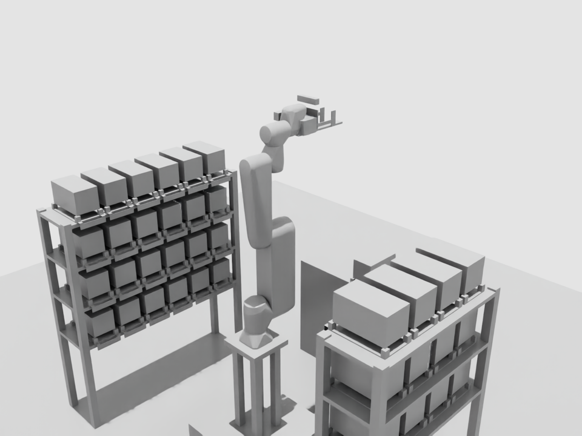

# P5 — Isaac Sim adapter

Date: 2026-11-22. Code: `src/rsf/compile/usd.py` (world → USD), `src/rsf/sim/isaac_cell.py`
(the run), `src/rsf/sim/common.py` (what both simulators share), `tools/sim_workflow.py --backend isaac`,
`tools/isaac/probe.py`. Tests: `tests/test_usd.py`.

The milestone (PLAN §7, P5): *the Isaac adapter loads the same world*. Same cell,
same servo, same report, same judge as the MuJoCo run, so a plan can be replayed in
either and the verdicts compared.

## Design

```
World ──rsf.compile.mjcf──► MjSpec ──► MujocoCell ─┐
   └────rsf.compile.usd───► USD stage ─► IsaacCell ─┼─► ExecReport ─► rsf.sim.judge
trajectory ─► rsf.sim.common.Reference (q_ref, qd_ref) ┘
```

| part | choice | why |
|---|---|---|
| scene format | USD with the core `UsdPhysics` schemas, PhysX settings as their attribute tokens | `usd-core` alone authors and tests it (no Isaac on CPU); Isaac's PhysX reads the same tokens |
| robot | the URDF written as an articulation here, not Isaac's URDF importer | the joints and frames are exactly the planner's; checked against the URDF's FK (< 1e-6) |
| links | links joined by fixed joints are one rigid body (named after the top link); every link is an `Xform` under its body with its collision meshes | PhysX needs mass on every body (`flange`, `gripper_base` have none); contacts still name the link (`gripper_body`, not `link_6`) |
| collision | boxes stay boxes; meshes as convex hulls (`MeshCollisionAPI convexHull`) | what MuJoCo collides, so the two runs see the same shapes |
| mass | objects: the object's mass shared by volume over its solids; links: URDF inertials, merged by the parallel axis theorem; links without `<inertial>` (the jaws) from their geometry at 1000 kg/m³ | MuJoCo's rules; masses and centres of mass checked against the compiled MuJoCo model |
| servo | arm: PD in the joint drives (`kp`, `kv` of `SimParams`; PhysX angular gains are per degree, converted), the integral as an applied joint force, links ignore gravity (= gravity compensation); jaws: position drive, 100 N limit | MuJoCo's servo, term for term |
| friction | materials `robot` 0.4, `object` 0.3, `static` 0.5, combine `max` | MuJoCo's combine rule; the plate–tray pair gets the robot value |
| contacts | `PhysxContactReportAPI` on the robot's bodies; per pair the deepest separation; robot–robot off (articulation self-collision off) | the judge's contact record: `{t, link, other, depth}` |
| runtime | `omni.physx` steps physics without rendering; `omni.physics.tensors` (numpy) for the articulation and objects | the long-stable low-level interfaces; nothing imported until a cell is made |
| looks | parts loaded from USD are shown by their **original prims, referenced** (materials and textures included) under a units / up-axis Xform; every physics schema in them removed, their colliders invisible (`IsaacParams.visuals`, default on; `--set visuals=false` shows the colliders) | the stage is rebuilt from the World so the physics is the planner's; the looks are only for the picture |

Names: USD prim names cannot contain `/`; every prim that stands for a model element
carries `customData` `rsf:name` (the solid / object / link / joint name), `rsf:kind`
and, for links, `rsf:body`, so contacts and poses map back to the names the judge uses.

Stage layout:

```
/World                      defaultPrim, Z up, metres, kilograms
  physicsScene              1 kHz, TGS, CPU dynamics
  materials/{robot,object,static}
  static/<solid>            colliders (504 boxes in strict)
  visuals/<entity>          the original USD prims of fixed parts, referenced (looks only, no physics)
    units/<prim>            the file's units and up axis -> metres, z up
  objects/<object>          rigid bodies, colliders below (the trays where the run starts them)
    visual                  the object's original USD prims (moves with the body)
  robot                     ArticulationRootAPI, self-collision off
    base, link_1 … link_6, left_gripper, right_gripper     rigid bodies
      <link>/collision_k    convex hulls
    joints/root_fixed, joint_1 … joint_6, *_gripper_joint
```

## What differs from MuJoCo (on purpose, documented)

| | MuJoCo | PhysX |
|---|---|---|
| contact | soft (`solref` 2 ms, `solimp` 0.95–0.99) | rigid, contact offset 2 mm, rest offset 0 |
| friction | one coefficient, elliptic cones, noslip | static = dynamic = the class value, patch friction |
| solver | implicit-fast, 1 kHz | TGS, 32 position / 4 velocity iterations, 1 kHz |
| drive limit | none | 10 kN m (`arm_max_torque`) |

`IsaacParams` (a `SimParams` with PhysX's own fields) holds these; `--set` changes
them as for MuJoCo.

## Running

```bash
pip install usd-core trimesh                 # authoring and tests (CPU)
PYTHONPATH=src python -m pytest tests/test_usd.py
```

Isaac Sim itself (Python 3.12 for 6.x, an RTX-class GPU):

```bash
pip install 'isaacsim[all,extscache]==6.2.0.0' --extra-index-url https://pypi.nvidia.com
OMNI_KIT_ACCEPT_EULA=YES python tools/isaac/probe.py                      # can it run here?
OMNI_KIT_ACCEPT_EULA=YES PYTHONPATH=src python tools/sim_workflow.py cells/tm_tray/layouts/strict.yaml \
    cells/tm_tray/workflows/inspect_and_sort.yaml --plan cells/tm_tray/plans/strict_inspect_and_sort_gpu.json \
    --backend isaac --transfers 2 --out reports/isaac_strict_1cycle.json
```

## Results (Kaggle, 2026-11-23)

Isaac Sim 6.2.0 (pip, Python 3.12) on a Kaggle T4, headless, CPU PhysX at 1 kHz
(`tools/isaac/kaggle_check.sh`; setup 10 min, mostly the Isaac download; checks 4 min).

| check | result |
|---|---|
| app start (headless) | 22 s (physics only without Vulkan; with it, see *Rendering on Kaggle*) |
| box on the ground (probe) | rests at z = 0.0500 m after 1 s |
| compiled strict stage (720 prims) | loads; one articulation, 8 DOF and 9 bodies, names as authored; 1000 steps in 1.07 s |
| `tests/test_isaac.py::test_cell_holds_still` | pass: arm held 2 s, trays seated, no contacts, tracking < 0.1 mm |
| strict first cycle (2 transfers, 103.8 s simulated) | **2/2 pass**, 137.7 s wall |

Same plan (`cells/tm_tray/plans/strict_cycle1_gpu.json.gz`, the 15 deg tilt plan of 2026-11-19; replaced on
2026-11-23 by `strict_cycle1.json.gz`, the 5 deg tilt), same judge, both simulators:

| transfer | backend | seat | slip | track | carry tilt | contacts |
|---|---|---|---|---|---|---|
| incoming/L2/C0 → table/L0/C0 | MuJoCo | 0.36 mm / 0.01° | 0.23 mm | 0.43 mm | 15.0° | none |
| | Isaac (PhysX) | 0.30 mm / 0.00° | 0.79 mm | 0.44 mm | 15.0° | none |
| table/L0/C0 → outgoing/L0/C0 | MuJoCo | 0.41 mm / 0.02° | 0.21 mm | 0.39 mm | 5.6° | none |
| | Isaac (PhysX) | 0.59 mm / 0.02° | 0.39 mm | 0.39 mm | 5.6° | none |

Tracking and tilt agree to 0.01 mm / 0.01° (the same servo on the same arm). Placement
and slip differ by up to 0.6 mm (the contact models differ: rigid PhysX contacts with
patch friction vs MuJoCo's soft contacts), all well inside the criteria (2 mm, 5 mm).

The first attempt simulated the cycle but the judge failed: it computed the planned
flange with EAIK, which is not installed with Isaac. The judge now uses the URDF's FK
(identical to 1e-15), and `sim_workflow --report` keeps the raw run before judging.

## Rendering on Kaggle (Vulkan)

Kaggle's container exposes the GPU for compute only (`NVIDIA_DRIVER_CAPABILITIES=compute,utility`):
no Vulkan driver, no ICD, so Isaac's RTX renderer cannot start. `tools/isaac/vulkan_setup.sh`
adds it, user space only (the kernel module is the host's):

1. the Vulkan loader (`apt install libvulkan1 vulkan-tools`);
2. the graphics libraries of the **running** driver version (580.178.04), extracted from
   NVIDIA's own installer (`NVIDIA-Linux-x86_64-<ver>.run --extract-only`, every library the
   container lacks; the mounted compute ones are kept), registered with `ldconfig`;
3. the ICD manifest (`/etc/vulkan/icd.d/nvidia_icd.json`) and NVIDIA's **EGL vendor** for
   glvnd (`/usr/share/glvnd/egl_vendor.d/10_nvidia.json`): the Vulkan driver finds its GPU
   through EGL; without it glvnd falls back to Mesa and `vkCreateInstance` returns
   `ERROR_INCOMPATIBLE_DRIVER` before the driver touches the GPU (seen with `strace`);
4. `/dev/nvidia-modeset` (created; opening it is not permitted, and not needed).

Result: `vulkaninfo` lists both T4s (Vulkan 1.4.312), and Isaac renders with RTX:



The first frame takes ~10 min (the RTX shaders compile for the T4); the prebuilt
environment below ships them compiled.

## Kaggle environment cache

Installing Isaac Sim takes ~10 min per run (pip, ~25 GB venv). A prebuilt environment
(`tools/isaac/kaggle_env_build.sh`, once, on a GPU kernel) installs it, renders one frame to
compile the shaders, and stores the venv as the kernel's output; later runs mount it
(`kaggle_run.sh run --env isaac62`) and restore it (`tools/isaac/kaggle_env_restore.sh`,
which also sets up Vulkan).

* The venv (~25 GB) is over Kaggle's 20 GB output limit: it is stored zstd-compressed
  (~11 GB).
* Kaggle's GPU image has no `zstd`, so the runner cannot unpack it itself: the runner's own
  `env.tar` holds only the uv Python, and the restore script installs `zstd` and unpacks the
  venv.

Measured (2026-11-23, T4):

| step | fresh install | prebuilt `isaac62` |
|---|---|---|
| Isaac Sim | 540–610 s (pip) | 158 s (unpack 10.7 GB → 24 GB) |
| Vulkan (`vulkan_setup.sh`) | 71 s | 71 s |
| first RTX frame (1280 × 960) | 630 s (shader compile) | 1.6 s (441 MB shader cache shipped) |
| next frames | 0.29 s | 0.29 s |
| render + Isaac tests + strict first cycle, whole kernel | ~1350 s | 638 s |

The cycle's verdict is the same with either (2/2, identical numbers).

```bash
# once (GPU kernel, ~25 min): install, warm the shaders, pack
bash kaggle_run.sh run --python 3.12 --slug kgt-env-isaac62 --timeout 100m \
    --setup "bash tools/isaac/kaggle_setup.sh" --cmd "bash tools/isaac/kaggle_env_build.sh"
# every run
bash kaggle_run.sh run --env isaac62 --setup "bash tools/isaac/kaggle_env_restore.sh" --cmd "..."
```

Vulkan is cached too (`nvidia-vk.tar.zst`, for the driver in `env.json`). A run on another
driver reinstalls Vulkan for the running one (11 s, NVIDIA's installer), still renders, and
marks the cache stale (`ISAAC_ENV_STALE`); `tools/isaac/kaggle_isaac.sh` then rebuilds the
cache by itself. Tested 2026-11-23 with a simulated driver change
(`ISAAC_ENV_ASSUME_CACHED_DRIVER=0.0`): detected, Vulkan reinstalled, RTX first frame 1.5 s,
rebuild started. Agents use this through the `isaac-sim-kaggle` skill
(`.claude/skills/isaac-sim-kaggle/SKILL.md`).

Rebuild it when the Isaac version changes or Kaggle's driver changes (the shader cache is
for this driver and GPU; `vulkan_setup.sh` always installs the libraries of the running
driver). Do not `fetch` the env kernel: its output is the 10.7 GB archive.

## Status

* Done: compiler, Isaac cell, the cross-check above.
* Next: the whole strict run (24 transfers, ~1000 s simulated, ~25 min on Kaggle) and
  as_built / recommended; sensitivity runs (priority 4, physical parameters) can use
  both simulators.
* Camera images in Isaac: possible on Kaggle with `tools/isaac/vulkan_setup.sh` (below).

### Compiler tests


* Compiler and its checks: done (`tests/test_usd.py`, 8 tests): FK of the authored
  articulation = URDF FK (< 1e-6 over random configurations), bodies authored where
  their joints put them, the flange frame, drives and limits, gravity off on the arm,
  static boxes and objects where the world has them, masses and centres of mass =
  MuJoCo's, names and physics materials, file round trip; the Isaac cell's name maps
  (contacts, flange) without Isaac.
* Isaac runtime: see below (Kaggle).
